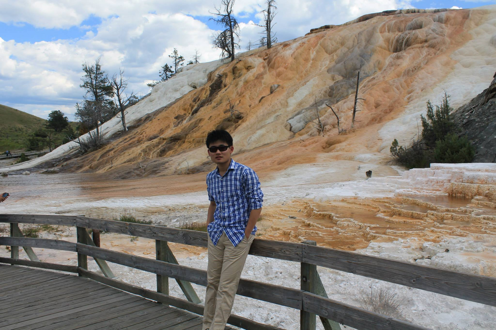

<link rel="stylesheet" href="https://cdnjs.cloudflare.com/ajax/libs/font-awesome/6.5.1/css/all.min.css">
<link rel="stylesheet" href="https://cdn.jsdelivr.net/gh/jpswalsh/academicons@1/css/academicons.min.css">

**Assistant Professor, [Department of Statistics](https://stat.as.uky.edu/)**

**[University of Kentucky](https://www.uky.edu/)**

Email: Zeya.Wang@uky.edu; Personal Email: zw17.rice@gmail.com

  <a href="https://scholar.google.com/citations?user=3xUT1e0AAAAJ&amp;hl=en" title="Google Scholar" aria-label="Google Scholar" style="margin-right: 16px;"><i class="ai ai-google-scholar"></i></a>
  <a href="https://www.linkedin.com/in/zeyawang/" title="LinkedIn" aria-label="LinkedIn"><i class="fa-brands fa-linkedin"></i></a>

I earned my Ph.D. in Statistics from [Rice University](https://www.rice.edu/), supervised by [Prof. Wenyi Wang](https://faculty.mdanderson.org/profiles/wenyi_wang.html) and [Prof. Jeffrey S. Morris](https://dbei.med.upenn.edu/staff/jeffrey-s-morris-phd/). My professional journey includes serving as a Senior Machine Learning Engineer, Tech Lead at TikTok, where I specialized in predictive modeling, video understanding, and anomaly detection. Additionally, I was a Research Scientist at Petuum Inc., a company founded by faculty from the Machine Learning Department at Carnegie Mellon University, where I worked with [Prof. Eric Xing](http://www.cs.cmu.edu/~epxing/) and focused on machine learning and medical imaging research. I have also held a significant role as a Postdoctoral Research Fellow at the University of Texas MD Anderson Cancer Center, where I delved into statistical modeling on omics data. 

My research interests encompass methodological studies for machine learning, statistical computing, graphical models, deep learning, and Bayesian inference, with a specific focus on machine intelligence, precision medicine, and biomarker detection.

## Professional Experience
* Assistant Professor, University of Kentucky, 2023 - Present

* Machine Learning Engineer, Tech Lead, TikTok, 2021 - 2023

* Research/Data Scientist, Petuum, 2017 - 2021

* Postdoc, UT MD Anderson Cancer Center, 2017

* Visiting Postdoc, Wellcome Sanger Institute, 2017

* Research Intern, IBM Research, 2016

## Publications

### Journal Publications
\* = authors contributed equally,  ✉︎ = corresponding author

* **Z. Wang**✉︎, L. Shang, Y. Ni, C. Ye (2026). [Adapt via Bayesian Nonparametric Clustering: Fine-Grained Classification for Model Recycling Under Domain and Category Shift](https://openreview.net/forum?id=J5B4yt7C37). _**Transactions on Machine Learning Research**_ 

* R. E. Binkley, S. Revolinski, E. E. Gotsick, R. S. Smith, **Z. Wang**, K. Mizuta (2026). [Deep Learning-Based Quantification of Tall Fescue Abundance in Pastures](https://doi.org/10.3389/fagro.2026.1749362). _**Frontiers in Agronomy**_

* **Z. Wang**✉︎, C. Ye (2025). [Deep Clustering Evaluation: How to Validate Internal Clustering Validation Measures](https://doi.org/10.1080/01621459.2025.2592926). _**Journal of the American Statistical Association**_

* Y. Ni, S. Chen, **Z. Wang** (2024). [Causal Structural Modeling of Survey Questionnaires via a Bootstrapped Ordinal Bayesian Network Approach](https://www.cambridge.org/core/product/0206D74E516FF9B99BE25AA71753D5F3).  _**Psychometrika**_

* **Z. Wang**, V. Baladandayuthapani, A. O. Kaseb, H. M. Amin, M. M. Hassan, W. Wang, J. S. Morris (2022). [Bayesian Edge Regression in Undirected Graphical Models to Characterize Interpatient Heterogeneity in Cancer](https://doi.org/10.1080/01621459.2021.2000866). _**Journal of the American Statistical Association**_

* **Z. Wang**✉︎, Y. Ni, B. Jing, D. Wang, H. Zhang, E. Xing (2021). [DNB: A Joint Learning Framework for Deep Bayesian Nonparametric Clustering](https://doi.org/10.1109/TNNLS.2021.3085891). _**IEEE Transactions on Neural Networks and Learning Systems**_

* J. Zhou, B. Jing, **Z. Wang**✉︎, H. Xin, H. Tong (2021). [Soda: Detecting covid-19 in chest x-rays with semi-supervised open set domain adaptation](https://doi.org/10.1109/TCBB.2021.3066331). _**IEEE/ACM Transactions on Computational Biology and Bioinformatics**_

* S. Kadambi\*, **Z. Wang**\*✉︎, E. Xing (2021). [WGAN domain adaptation for the joint optic disc-and-cup segmentation in fundus images](https://doi.org/10.1007/s11548-020-02144-9). _**International Journal of Computer Assisted Radiology and Surgery**_

* J. S. Morris, M. M. Hassan, Y. E. Zohner, **Z. Wang**, L. Xiao, A. Rashid, A. Haque, R. Abdel‐Wahab, Y. A. Mohamed, K. L. Ballard, R. A. Wolff, B. George, L. Li, G. Allen, M. Weylandt, D. Li, W. Wang, K. Raghav, J. Yao, H. M. Amin, A. O. Kaseb (2020). [HepatoScore‐14: Measures of biological heterogeneity significantly improve prediction of hepatocellular carcinoma risk](https://doi.org/10.1002/hep.31555). _**Hepatology**_

* **Z. Wang**, S. Cao, J. S. Morris, J. Ahn, R. Liu, S. Tyekucheva, F. Gao, B. Li, W. Lu, X. Tang, I. I. Wistuba, M. Bowden, L. Mucci, M. Loda, G. Parmigiani, C. C. Holmes, W. Wang (2018). [Transcriptome Deconvolution of Heterogeneous Tumor Samples with Immune Infiltration](https://doi.org/10.1016/j.isci.2018.10.028). _**iScience (Cell Press)**_

* A. Z. Holik, C. W. Law, R. Liu, **Z. Wang**, W. Wang, J. Ahn, M.-L. Asselin-Labat, G. K. Smyth, M. E. Ritchie (2017). [RNA-seq mixology: designing realistic control experiments to compare protocols and analysis methods](https://doi.org/10.1093/nar/gkw1063). _**Nucleic acids research**_

### Conference Publications

* Y. Ni, D. Jones, **Z. Wang** (2020). [Consensus Variational and Monte Carlo Algorithms for Bayesian Nonparametric Clustering](https://ieeexplore.ieee.org/document/9378319). _**IEEE International Conference on Big Data (IEEE BigData)**_

* **Z. Wang**, B. Jing, Y. Ni, N. Dong, P. Xie, E. Xing (2020). [Adversarial domain adaptation being aware of class relationships](https://doi.org/10.3233/FAIA200267). _**European Conference on Artificial Intelligence (ECAI)**_ (Oral Presentation)

* B. Jing, **Z. Wang**, E. Xing (2019). [Show, Describe and Conclude: On Exploiting the Structure Information of Chest X-ray Reports](https://aclanthology.org/P19-1657/). _**Annual Meeting of the Association for Computational Linguistics (ACL)**_

* **Z. Wang**, N. Dong, S. D. Rosario, M. Xu, P. Xie, E. Xing (2019). [Ellipse Detection of Optic Disc-and-Cup Boundary in Fundus Images](https://ieeexplore.ieee.org/abstract/document/8759173).  _**IEEE 16th International Symposium on Biomedical Imaging (ISBI)**_ 

* W. Dai, N. Dong, **Z. Wang**, X. Liang, H. Zhang, E. Xing (2018). [SCAN: Structure correcting adversarial network for organ segmentation in chest X-rays](https://link.springer.com/chapter/10.1007/978-3-030-00889-5_30). _**International Workshop on Deep Learning in Medical Image Analysis(DLMIA)**_ 

* N. Dong, M. Kampffmeyer, X. Liang, **Z. Wang**, W. Dai, E. Xing (2018). [Reinforced Auto-Zoom Net: Towards Accurate and Fast Breast Cancer Segmentation in Whole-slide Images](https://doi.org/10.1007/978-3-030-00889-5_36). _**International Workshop on Deep Learning in Medical Image Analysis (DLMIA)**_ 

* N. Dong, M. Kampffmeyer, X. Liang, **Z. Wang**, W. Dai, E. Xing (2018). [Unsupervised domain adaptation for automatic estimation of cardiothoracic ratio](https://doi.org/10.1007/978-3-030-00934-2_61). _**International Conference on Medical Image Computing and Computer-Assisted Intervention (MICCAI)**_ 

* **Z. Wang**, N. Dong, W. Dai, S. D. Rosario, E. Xing (2018). [Classification of Breast Cancer Histopathological Images using Convolutional Neural Networks with Hierarchical Loss and Global Pooling](https://doi.org/10.1007/978-3-319-93000-8_84). _**International Conference Image Analysis and Recognition (ICIAR)**_  (Oral Presentation)

## Contributed Softwares

* [DeMixT](https://www.google.com/url?q=https%3A%2F%2Fwww.bioconductor.org%2Fpackages%2Frelease%2Fbioc%2Fhtml%2FDeMixT.html&sa=D): A Computational Tool for Cell Type-specific Deconvolution of Heterogeneous Tumor Samples Using Expression Data from RNAseq or Microarray Platforms

* [AutoDist](https://www.google.com/url?q=https%3A%2F%2Fgithub.com%2Fpetuum%2Fautodist&sa=D): A Composable and Automated Synchronization System for Distributed Deep Learning

* [Tuun](https://www.google.com/url?q=https%3A%2F%2Fgithub.com%2Fpetuum%2Ftuun&sa=D): A Toolkit for Efficient Hyperparameter Tuning via Uncertainty Modeling, with a Focus on Flexible Model choice, Scalability, and Use in Distributed Settings.

## Academic Activities

### Program Committee Members or Reviewers for:
* Journals
  * <ins>Statistics</ins>: Statistica Sinica, Annals of Applied Statistics, Journal of the Royal Statistical Society: Series C, Journal of Applied Statistics, Journal of Educational and Behavioral Statistics, Communications in Statistics, Chemometrics and Intelligent Laboratory Systems
  * <ins>Machine Learning & AI</ins>: Journal of Machine Learning Research, Artificial Intelligence Review, Knowledge and Information Systems, Information Sciences, IEEE Transactions on Cybernetics, IEEE Transactions on Signal Processing, Neurocomputing, Engineering Applications of Artificial Intelligence, Image and Vision Computing, Signal Image and Video Processing, Journal of Network and Computer Applications, Journal of Supercomputing, PeerJ Computer Science
  * <ins>Bioinformatics & Biomedical</ins>: eLife, BMC Genomics, Mathematical Biosciences, Computational Biology and Chemistry, Computers in Biology and Medicine, Computer Methods and Programs in Biomedicine, Biomedical Signal Processing \& Control, Journal of Digital Imaging
  * <ins>Multidisciplinary</ins>: Scientific Reports, PLOS One, Journal of Cleaner Production

* Conferences
  * <ins>Machine Learning & AI</ins>: The Conference on Neural Information Processing Systems (NeurIPS; Top Reviewer in NeurIPS 2025), International Conference on Learning Representations (ICLR), The AAAI Conference on Artificial Intelligence (AAAI), The Conference on Empirical Methods in Natural Language Processing (EMNLP), ACM International Conference on Web Search and Data Mining (WSDM), International Conference on Intelligent Computing (ICIC)
  * <ins>Bioinformatics</ins>: International Symposium on Bioinformatics Research and Applications (ISBRA), IEEE International Conference on Bioinformatics and Biomedicine (BIBM)
  
### Teaching Experience:
* Instructor of STA 630: Bayesian Inference, Spring 2025, University of Kentucky
* Instructor of STA 629/695: Statistical Machine Learning and Predictive Modeling, Fall 2023/2024, University of Kentucky
* Instructor of STA 652: Advanced Statistical Models, Spring 2024, University of Kentucky
* TA of STAT 581: Mathematical Probability I, Fall 2014, Rice University

## Alumni Students:
- Xinrong Hu, Graduate Intern (2022) -> Machine Learning Scientist @ TikTok

- Alexander Gurung, Graduate Intern (2021) -> AI Resident @ Facebook

## Social Activities
I'm also a soccer enthusiast and have played striker for amateur teams like Phoenix FC, Riverrats FC, and Partizan Pittsburgh FC in the Greater Pittsburgh Soccer League.
